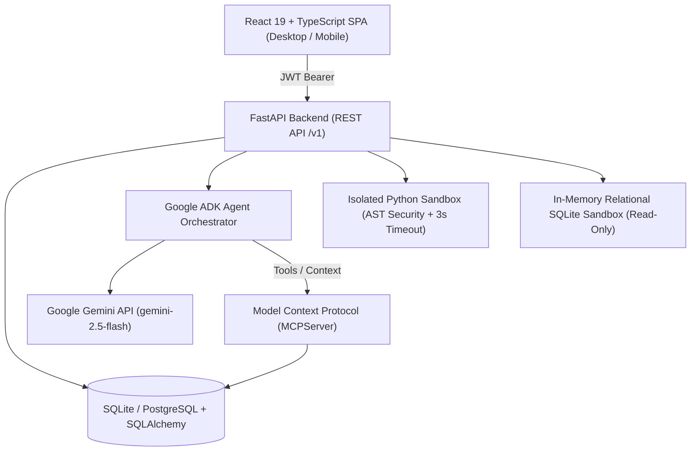

# CareerForge AI — Autonomous Career Preparation Platform

[](https://www.python.org/)
[](https://fastapi.tiangolo.com/)
[](https://react.dev/)
[](https://cloud.google.com/)
[](https://modelcontextprotocol.io/)
[](https://cloud.google.com/run)

**CareerForge AI** is an AI-powered career intelligence and preparation platform engineered to secure Software Development Engineer (SDE) positions before 2027 graduation. It provides verified skill assessments, a 4-hour adaptive daily curriculum, isolated Python and SQL coding sandboxes, mock interviews with transparent rubrics, job application tracking from permitted sources, and an AI career coach orchestrated via Google Agent Development Kit (ADK) and Gemini.

---

## 1. System Architecture



---

## 2. Core Capabilities & Modules

1. **Career Intelligence Dashboard**: Real-time display of today's study plan, measured skill scores, weekly progress, sandbox practice counts, job pipeline, and overdue tasks. Uses 100% persisted data without fabricated statistics.
2. **AI Career Coach (Google ADK)**: Conversational coach understanding the student's B.Tech AI & Data Science profile, 2027 timeline, 4-hour daily budget, target companies (Zoho, TCS, Amazon, PayPal), and long-term professorship roadmap. Seamlessly falls back to a deterministic persona if offline or when quota is exceeded.
3. **Skill Assessment Engine**: Topic-wise question banks for **Python, SQL, DSA, Aptitude, OOP, DBMS, Operating Systems, and Computer Networks**. Calculates measured proficiency from actual assessments and distinguishes it from subjective confidence (1-5).
4. **Isolated Python Coding Sandbox**: Deterministic test runner with static AST security inspection (blocking `import os`, `subprocess`, `open`, etc.) and a 3-second execution timeout. Explains failed test cases without leaking hidden test inputs.
5. **SQL Practice Relational Sandbox**: Evaluates learner queries against ground-truth relational data (`departments`, `employees`, `students`, `courses`, `orders`). Strictly enforces read-only `SELECT` operations.
6. **Mock Interview Simulator**: Multi-round simulations across Technical, HR, Project, and Aptitude modes with transparent scoring rubrics for clarity, correctness, and communication.
7. **4-Hour Adaptive Study Planner**: Generates a 7-day preparation sprint apportioning 75 mins to DSA, 45 mins to Python, 45 mins to SQL, 45 mins to Core CS/Aptitude, and 30 mins to Projects.
8. **Job Application Tracker**: Full pipeline management (`saved`, `planned`, `applied`, `assessment`, `interview`, `offer`, `rejected`). Integrates approved portals (Zoho, TCS, Amazon, PayPal) with strict confirmation requirements before external submissions.
9. **Resume & Project Assistant**: ATS keyword alignment analyzer (never fabricates achievements) and deep-dive technical interview question generator for RAG Chatbot and Facial Recognition projects.
10. **Weekly Progress Review**: Synthesizes verified weekly events, completion rates, problems solved, weaknesses, and the top 3 priorities for the subsequent week.
11. **Model Context Protocol (MCP)**: Implements official MCP 2.x server with narrow-permission tools (`read_skill_profile`, `record_study_session`, `get_assessment_history`, `read_application_tracker`, `search_approved_jobs`, `save_job_listing`, `generate_weekly_summary`).

---

## 3. Technology Stack

- **Backend**: FastAPI 0.141, Python 3.11+ / 3.14, SQLAlchemy 2.1, Pydantic 2.14, Alembic
- **AI & Tools**: Google Agent Development Kit (`google-adk 2.12`), Google GenAI SDK (`google-genai 2.31`), Model Context Protocol (`mcp 2.3`)
- **Frontend**: React 19, TypeScript, Vite, Vanilla CSS with custom design tokens, Lucide Icons
- **Database**: SQLite for local dev & testing; PostgreSQL ready for Cloud SQL production
- **Security**: JWT authentication, bcrypt password hashing, AST code sandboxing, token-authenticated MCP
- **Testing**: pytest (21 automated backend tests)
- **Deployment**: Google Cloud Run (containerized with Docker and Nginx)

---

## 4. Prerequisites

- Python 3.11 or higher (Python 3.14 virtual environment included in `cf/`)
- Node.js 20+ / 22+ & npm 10+
- Git

---

## 5. Local Setup & Execution

### A. Activate Virtual Environment
```powershell
# Windows PowerShell
.\cf\Scripts\activate
```

### B. Configure Environment
```bash
cp .env.example .env
```
*(Optional: Add your `GEMINI_API_KEY` to `.env` to enable live Gemini API calls; offline fallback is active by default).*

### C. Run Automated Tests
```powershell
# Run the 21 pytest integration tests
.\cf\Scripts\pytest.exe backend\tests -v
```

### D. Start Backend Server
```powershell
.\cf\Scripts\python.exe -m uvicorn backend.app.main:app --host 0.0.0.0 --port 8000 --reload
```
*API Swagger Documentation will be available at:* `http://localhost:8000/docs`

### E. Start Frontend Server
In a separate terminal:
```bash
cd frontend
npm run dev
```
*Frontend application will be accessible at:* `http://localhost:5173`

**Default Credentials for Instant Access:**
- Email: `student@careerforge.ai`
- Password: `CareerForge2027!`

---

## 6. Google Cloud Run Deployment

### Option 1: Automated Script (PowerShell)
```powershell
.\cloudrun\deploy.ps1 -ProjectId "YOUR_GCP_PROJECT_ID" -Region "us-central1"
```

### Option 2: Automated Script (Bash)
```bash
chmod +x cloudrun/deploy.sh
./cloudrun/deploy.sh YOUR_GCP_PROJECT_ID us-central1
```

### Option 3: Manual Cloud CLI Commands
```bash
# 1. Build and push backend image
gcloud builds submit --tag gcr.io/$PROJECT_ID/careerforge-backend:latest -f backend/Dockerfile .

# 2. Deploy Backend
gcloud run deploy careerforge-backend \
    --image gcr.io/$PROJECT_ID/careerforge-backend:latest \
    --platform managed \
    --region us-central1 \
    --allow-unauthenticated \
    --port 8080 \
    --memory 512Mi \
    --set-env-vars="ENVIRONMENT=production,DEBUG=False"

# 3. Build and push frontend image
gcloud builds submit --tag gcr.io/$PROJECT_ID/careerforge-frontend:latest -f frontend/Dockerfile .

# 4. Deploy Frontend
gcloud run deploy careerforge-frontend \
    --image gcr.io/$PROJECT_ID/careerforge-frontend:latest \
    --platform managed \
    --region us-central1 \
    --allow-unauthenticated \
    --port 8080 \
    --memory 256Mi
```

---

## 7. Security & Sandboxing Architecture

- **AST Code Sandboxing**: Prevents arbitrary execution by parsing Python abstract syntax trees and disallowing all file system (`open`), OS (`os`, `subprocess`), network (`socket`, `urllib`), and introspection builtins.
- **Subprocess Isolation**: Runs coding tests in isolated temporary execution environments with a 3.0-second timeout.
- **Read-Only Relational Sandboxing**: Rejects queries containing `INSERT`, `UPDATE`, `DELETE`, `DROP`, or `ALTER` keywords to guarantee data immutability.
- **Zero Committed Secrets**: `.env` is gitignored. Production secrets use Google Secret Manager.

---

## 8. Verification & Acceptance Checklist

- [x] **Frontend builds cleanly**: Vite + React 19 + TypeScript builds to `dist/` in 1.7s.
- [x] **Backend starts cleanly**: FastAPI engine initializes, creates tables, and responds 200 OK on `/health`.
- [x] **ADK & Gemini agent runs**: Persona coach generates targeted plans and handles offline/quota fallbacks seamlessly.
- [x] **Persisted assessment results**: Scores and breakdowns update measured proficiency metrics.
- [x] **4-Hour Study Planner**: 7-day sprint schedules tasks and updates the dashboard when completed.
- [x] **Restricted Python Coding Sandbox**: Deterministic test checking with AST validation and hidden-test shielding.
- [x] **Relational SQL Sandbox**: Read-only query execution verified against expected queries.
- [x] **Job tracker persistence**: Correctly stores and transitions statuses across 8 pipeline stages.
- [x] **Automated tests pass**: All 21 pytest integration tests pass.
- [x] **Google Cloud Run ready**: Multi-stage Dockerfiles, Knative service YAML, and deploy scripts prepared.
